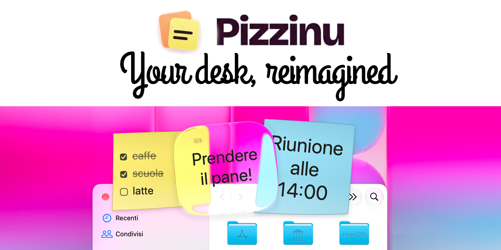
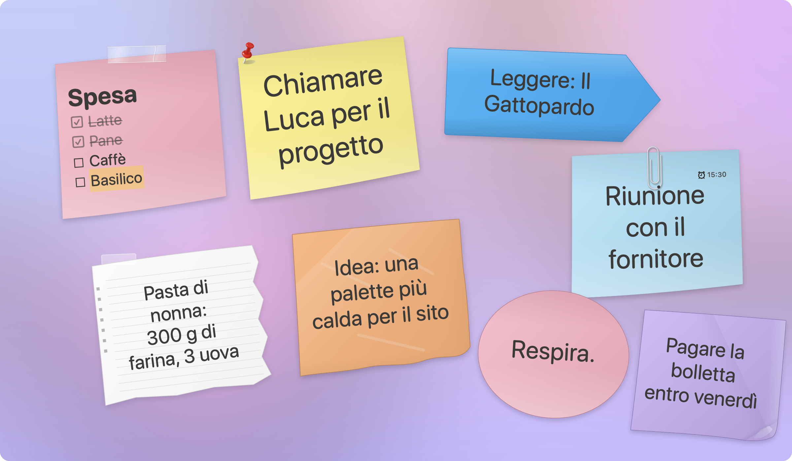
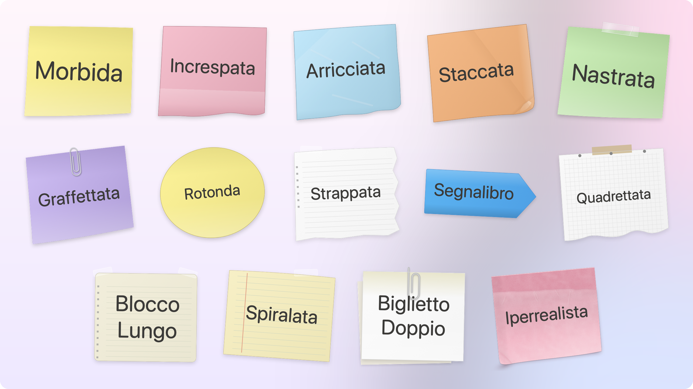
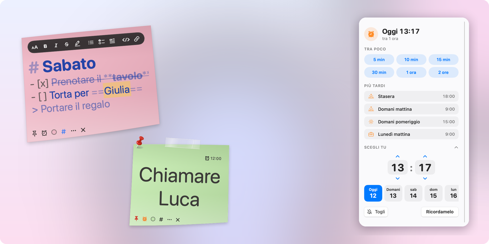
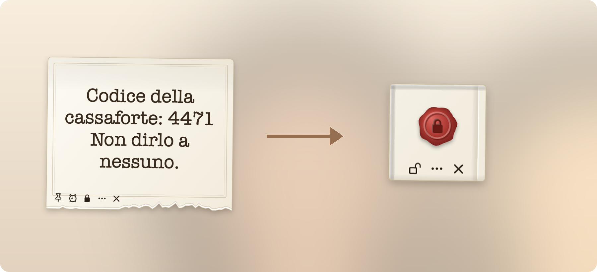
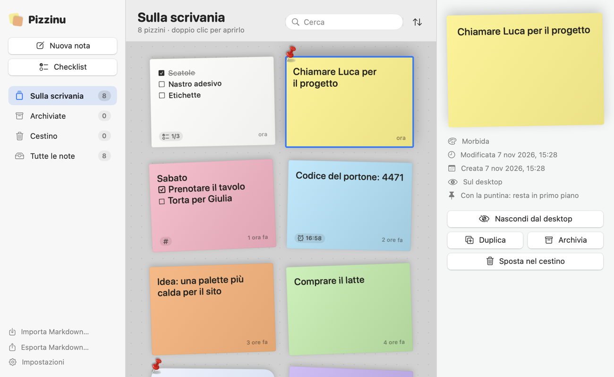

# Pizzinu

🇬🇧 [English](README.md) · 🇮🇹 Italiano · 🌐 [piratepixel.it/pizzinu](https://www.piratepixel.it/pizzinu/) ·
[Scarica](https://github.com/piratepxl/pizzinu/releases/latest) · [Telegram](https://t.me/pizzinuapp)

*Un'app [Piratepixel](https://www.piratepixel.it).*

<p align="center">
  <a href="https://github.com/piratepxl/pizzinu/releases"></a>
  <a href="https://github.com/piratepxl/pizzinu/releases/latest"></a>
  
  <a href="LICENSE"></a>
  <a href="https://t.me/pizzinuapp"></a>
</p>

<p align="center">
  <a href="https://github.com/piratepxl/pizzinu/releases/download/v1.2.0/Pizzinu-promo.mp4"></a><br>
  <sub>▶︎ <a href="https://github.com/piratepxl/pizzinu/releases/download/v1.2.0/Pizzinu-promo.mp4">Guarda il video completo con l'audio</a> (MP4, 40 s)</sub>
</p>

<p align="center"></p>

**Post-it digitali per macOS.** Pizzinu mostra ogni nota come un vero foglietto adesivo
appoggiato sulla scrivania: finestre flottanti indipendenti, carta disegnata in forma vettoriale
con volume e ombre, salvataggio locale automatico e un'icona nella barra dei menu sempre a
portata di mano.

L'applicazione è nativa (AppKit + SwiftUI, nessuna dipendenza esterna), **leggera** (~25 MB
di memoria a riposo, 0 % di CPU) e **local-first**: le note restano su questo Mac, senza account. L'unica
connessione è il controllo giornaliero degli aggiornamenti su GitHub, anonimo e disattivabile.

---

## Funzionalità

- **Scorciatoia globale ⌥⌘N.** Da qualsiasi app, senza cambiare finestra: premi, scrivi, **Esc**
  e torni al lavoro. Un pizzino lasciato vuoto sparisce da solo. Usa `RegisterEventHotKey`:
  nessun permesso di Accessibilità richiesto. Disattivabile nelle Impostazioni.
- **Puntina.** Il pulsante con la puntina (in basso a sinistra) fissa il pizzino: compare la
  puntina rossa in alto a sinistra del foglietto, con qualunque tema, e la nota passa e resta
  **sopra le altre finestre**. Le note senza puntina si fanno coprire come normali finestre: non
  esiste più il «sempre in primo piano» predefinito.
- **Promemoria con orario.** L'icona dell'orologio apre un selettore moderno che mette prima i
  minuti (5, 10, 15, 30 minuti, 1 o 2 ore), poi i suggerimenti (stasera, domani mattina e
  pomeriggio, lunedì) e infine ora e giorno a scelta. All'ora giusta il pizzino ricompare, passa in
  primo piano e **trema** finché non lo tocchi; in alto a destra resta l'etichetta «⏰ 15:30».
  Nessuna notifica di sistema. Un unico timer per tutti i promemoria, riallineato al risveglio dal
  riposo e ai cambi d'ora.
- **Trascina il testo.** Seleziona una frase in qualsiasi app e lasciala sulla scrivania: diventa
  un pizzino nel punto in cui l'hai lasciata. Disattivabile nelle Impostazioni.
- **Pizzino segreto.** Dal menu della nota lo proteggi con una password: il testo viene cifrato
  (AES-256-GCM autenticato; chiave da PBKDF2-SHA256 a 1.000.000 di iterazioni, sale casuale per
  pizzino, HKDF e dati associati) e nell'archivio, nei backup e nei file esportati c'è solo il testo
  cifrato. Dopo 3 password sbagliate c'è un'attesa crescente; i pizzini aperti si richiudono da soli
  dopo 5 minuti senza scriverci, con lo stop, con lo schermo bloccato o il salvaschermo; la loro
  finestra non compare in screenshot e condivisioni dello schermo. Aperto, il pizzino è
  un foglio da lettera **avorio con doppia cornice, strappato in basso**, scritto a macchina; chiuso a
  chiave **si piega a quadrato in 3D** e mostra un **sigillo di ceralacca**; con un doppio clic e la
  password si dispiega. Si richiude con il lucchetto,
  nascondendo la nota e alla chiusura dell'app. Se dimentichi la password il testo non si recupera.
- **Foglio Markdown.** L'icona `#` trasforma un pizzino in foglio Markdown: in lettura mostra
  titoli, **grassetto**, *corsivo*, ~~barrato~~, ==evidenziato==, `codice`, citazioni, elenchi
  puntati e numerati, **attività `- [ ]` spuntabili con un clic** e collegamenti cliccabili; con
  il doppio clic si scrive il sorgente, in **inchiostro blu** perché si veda che è il sorgente
  (doppio clic di nuovo o Esc per tornare alla lettura), con elenchi che continuano andando a capo,
  Tab/⇧Tab per i rientri, ⌘B, ⌘I, ⌘K, ⌘E per grassetto, corsivo, link e codice e una **barra
  fluttuante** con titoli, grassetto, corsivo, barrato, evidenziato, elenchi, attività, citazioni,
  codice e collegamenti. Una checklist
  trasformata in foglio Markdown diventa un elenco di attività. Tornando a nota semplice si vede
  solo il testo, senza simboli; riattivando il Markdown la formattazione ricompare.
- **Checklist annidate fino a tre livelli**, con caselle disegnate nel colore dell'inchiostro e
  proporzionate al carattere, spuntabili con un clic anche senza aprire la scrittura; cascata di
  completamento bidirezionale; Invio su una voce vuota rientrata la riporta indietro di un livello.
- **Grafica realistica del foglietto** disegnata con tracciati vettoriali: ombra morbida,
  superficie con variazione di luminosità, bordo naturale. Nitida su Retina a ogni dimensione.
- **15 temi della carta**, assegnati a caso alle note nuove e cambiabili per singola nota:
  Morbida, Increspata, Arricciata, Staccata, Nastrata, Graffettata, Rotonda, Strappata,
  Segnalibro (nastro largo e basso, con la punta), Quadrettata, Blocco Lungo, Spiralata, Biglietto Doppio, **Iperrealista** (un post-it vero attaccato al muro: striscia adesiva, carta che si stacca, angolo sollevato) e **Liquid Glass**
  (vetro di sistema `NSGlassEffectView` su macOS 26, senza riflessi aggiunti; il pannello mantiene sempre l'aspetto attivo, così il vetro resta trasparente anche quando la nota non ha il fuoco — soluzione sperimentale, vedi docs/LIMITS.md).
- **Palette di 12 colori** con un nome per ciascuno, più **colore personalizzato** per nota. I temi con
  una carta di colore proprio (Strappata, Segnalibro, Quadrettata, Blocco Lungo, Spiralata, Biglietto
  Doppio, Liquid Glass) non mostrano la scelta del colore.
- **Carattere della nota** scelto per singola nota, con i caratteri della cartella `Fonts`.
- **Colore del testo** per singola nota: grafite (grigio scuro, predefinito), nero, blu penna,
  rosso, verde, seppia.
  La dimensione si adatta da sola al testo: la nota resta sempre piena.
- **Interazione**: clic singolo = trascina, doppio clic = scrivi, Esc = chiudi la scrittura.
- **Salvataggio automatico** differito su SQLite; posizione e dimensioni persistenti.
- **Archivio a bacheca o a elenco** (a scelta): le note come foglietti su un piano puntinato o in un
  elenco compatto, con ricerca, ordinamento,
  **archiviazione**, **cestino recuperabile** e svuotamento automatico opzionale.
- **Aggiornamenti automatici.** Una volta al giorno Pizzinu controlla se c'è una versione nuova e
  mostra le novità; con un clic la scarica, ne verifica la firma, sostituisce l'app e la riapre.
  Disattivabile in Impostazioni ▸ Aggiornamenti.
- **Importazione ed esportazione in Markdown**: un file `.md` per nota, con un piccolo blocco
  di metadati che conserva colore, tema, puntina e promemoria (formato in
  [docs/MARKDOWN_FORMAT.md](docs/MARKDOWN_FORMAT.md)). Ogni pizzino si apre anche in Obsidian o
  in qualunque editor; si importano anche file Markdown scritti altrove.
- **Menu bar** (`NSStatusItem`): il clic crea subito una nuova nota, il clic destro apre il menu.
- **Avvio automatico all'accesso** opzionale (`SMAppService`). **Interfaccia in italiano e in inglese**, scelta in automatico dalla lingua del Mac.

## Immagini

**Ogni nota è un vero foglietto** sulla scrivania: lo trascini, ci scrivi, lo fissi con la puntina.

<p align="center"></p>

**13 temi di carta**, più il vetro Liquid Glass di sistema su macOS 26. Le note nuove ne ricevono uno a caso.

<p align="center"></p>

**Fogli Markdown** con la barra fluttuante, **puntina** e **promemoria** con il selettore che parte dai minuti.

<p align="center"></p>

**Pizzino segreto**: cifrato con una password, si piega a quadrato e si chiude con la ceralacca.

<p align="center"></p>

**L'archivio**: tutte le note come foglietti su una bacheca, oppure in elenco.

<p align="center"></p>

## Requisiti

- Mac con processore **Apple Silicon** (`arm64`), **macOS 14 Sonoma** o successivo.
- Per **compilare**: Swift 6 e i **Command Line Tools** di Apple (`xcode-select --install`).
  Non è richiesto Xcode.

## Compilazione

```bash
bash build.sh
```

Lo script ripiega da solo sull'SDK `MacOSX26.5.sdk` quando il plugin `SwiftUIMacros` manca (soli
Command Line Tools con SDK 27), compila `Pizzinu`, `PizzinuKit` e il self-test, genera l'icona,
copia nel bundle puntina (`Resources/Pin.png`) e caratteri, firma ad-hoc in una cartella di
passaggio **fuori dal progetto** e copia il risultato in **`build/Pizzinu.app`**.
`bash build.sh --install` lo copia anche in `/Applications`.

> **Perché la firma avviene fuori dal progetto.** In una cartella sincronizzata (Nextcloud, iCloud
> Drive) il file provider riapplica attributi estesi che invalidano la firma. Vedi
> [docs/INSTALL.md](docs/INSTALL.md).

### Self-test

```bash
export SDKROOT=/Library/Developer/CommandLineTools/SDKs/MacOSX26.5.sdk
"$(swift build -c release --scratch-path "${TMPDIR}pizzinu-build-release" --show-bin-path)/PizzinuSelfTest"
```

Stato attuale: **451 verifiche superate, 0 fallite**. Il ciclo completo del pizzino segreto nella
logica dell'app si verifica con `PIZZINU_CHECK_SECRET=1 build/Pizzinu.app/Contents/MacOS/Pizzinu`
(18 verifiche su un archivio temporaneo) (vedi [docs/TEST_REPORT.md](docs/TEST_REPORT.md)).

## Scorciatoie da tastiera

| Comando | Scorciatoia |
| --- | --- |
| **Pizzino al volo, da qualsiasi app** | **⌥⌘N** (globale) |
| Chiudi la scrittura (e torna all'app di prima) | Esc |
| Nuova nota / Nuova checklist | ⌘N / ⇧⌘N |
| Elenco delle note / Cerca | ⌘L / ⌘F |
| Importa da Markdown / Esporta in Markdown | ⇧⌘I / ⇧⌘E |
| Note attive / archiviate / cestino | ⌘1 / ⌘2 / ⌘3 |
| Mostra / nascondi tutte le note | ⇧⌘M / ⇧⌘H |
| Alterna la visibilità delle note | ⌥⌘H |
| Apri / duplica / archivia la nota | ⌘O / ⌘D / ⇧⌘A |
| Sposta la nota nel cestino | ⌘⌫ |
| Foglio Markdown: grassetto, corsivo, link, codice | ⌘B, ⌘I, ⌘K, ⌘E |
| Impostazioni | ⌘, |

## Struttura del progetto

```
Pizzinu/
├── Package.swift              # manifest SwiftPM (app, libreria, self-test)
├── build.sh                   # build release, assemblaggio e firma ad-hoc
├── Packaging/                 # entitlements dell'app
├── Resources/                 # AppIcon.icns, Pin.png (puntina)
├── Fonts/                     # caratteri delle note, copiati nel bundle
├── Scripts/                   # generazione dell'icona
├── Sources/
│   ├── PizzinuKit/            # dominio: Models, Persistence, Preferences,
│   │                          # Rendering, ImportExport (Markdown), Integrations
│   ├── Pizzinu/               # app AppKit/SwiftUI
│   └── PizzinuSelfTest/       # runner di verifica del nucleo
└── docs/                      # documentazione tecnica
```

## Documentazione

| Documento | Contenuto |
| --- | --- |
| [docs/ARCHITECTURE.md](docs/ARCHITECTURE.md) | Architettura, database, flussi principali |
| [docs/MARKDOWN_FORMAT.md](docs/MARKDOWN_FORMAT.md) | Formato di scambio: un file `.md` per nota |
| [docs/INSTALL.md](docs/INSTALL.md) | Installazione e avvio |
| [docs/TEST_REPORT.md](docs/TEST_REPORT.md) | Test automatici e verifiche manuali |
| [docs/PERFORMANCE.md](docs/PERFORMANCE.md) | Memoria e CPU |
| [docs/LIMITS.md](docs/LIMITS.md) | Limiti noti |
| [docs/NEXTCLOUD_ROADMAP.md](docs/NEXTCLOUD_ROADMAP.md) | Roadmap dell'integrazione con Nextcloud Notes |

## Chi fa Pizzinu: Piratepixel

Pizzinu è un'app di **Piratepixel**, il nome con cui progetto e pubblico il mio software: app
piccole e native, che fanno bene una cosa sola, pesano poco sul Mac e rispettano la privacy.

- Pagina di Pizzinu: **[piratepixel.it/pizzinu](https://www.piratepixel.it/pizzinu/)**
- Gli altri progetti Piratepixel: [piratepixel.it](https://www.piratepixel.it)
- Codice, versioni da scaricare e segnalazioni: qui su GitHub
  ([Release](https://github.com/piratepxl/pizzinu/releases/latest) ·
  [Issues](https://github.com/piratepxl/pizzinu/issues))

## Licenza

Pizzinu è distribuito con licenza **MIT** (vedi [LICENSE](LICENSE)), © 2026 Piratepixel. Le attribuzioni dei progetti open source
e le licenze dei caratteri sono in [THIRD_PARTY_NOTICES.md](THIRD_PARTY_NOTICES.md).

## Community

- **Canale Telegram** [@pizzinuapp](https://t.me/pizzinuapp): novità e nuove versioni.
- **Chat Telegram** [@pizzinuchat](https://t.me/pizzinuchat): domande, consigli e idee con gli altri utenti.
- Problemi e proposte: [GitHub Issues](https://github.com/piratepxl/pizzinu/issues).

## Sostieni Pizzinu

Pizzinu è gratuito e open source. Se ti è utile, puoi offrirmi un caffè su
[Ko-fi](https://ko-fi.com/piratepxl) ☕
