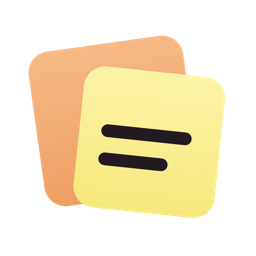
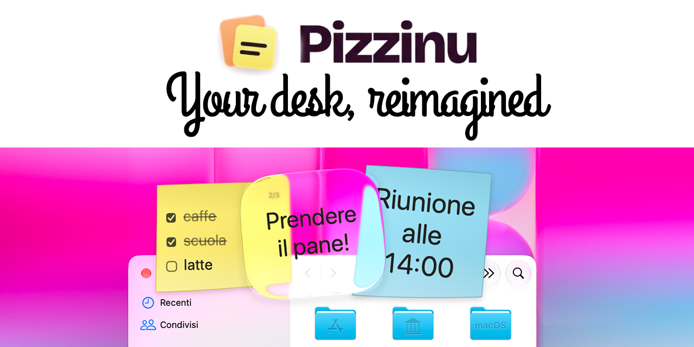
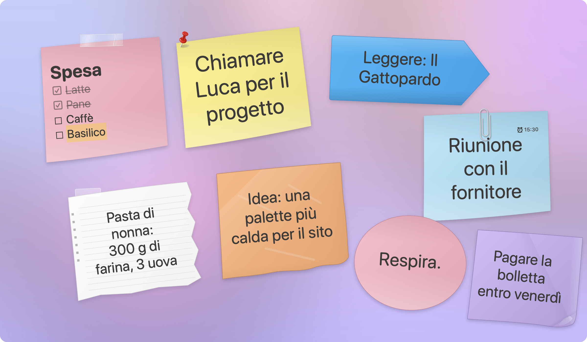
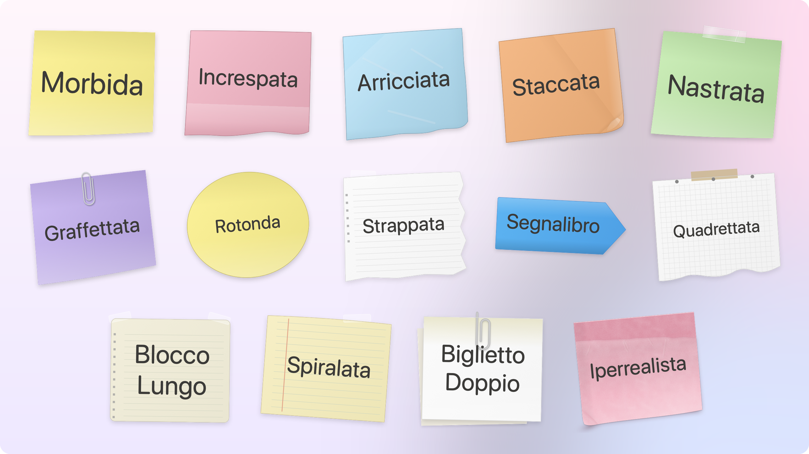
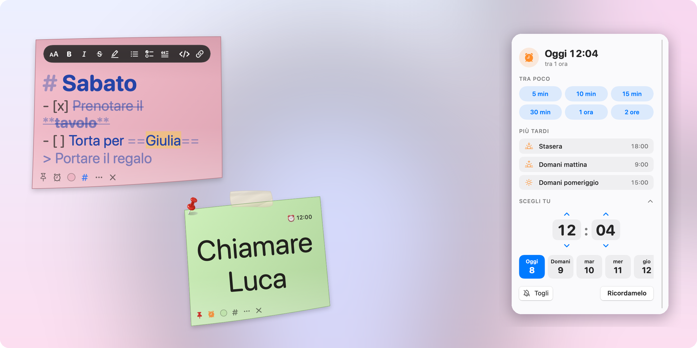
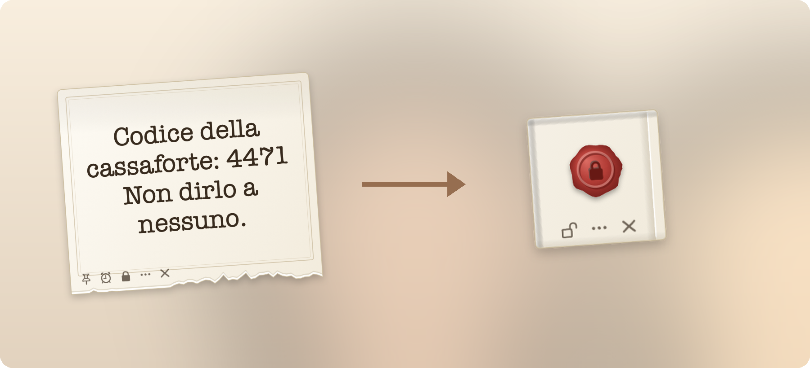
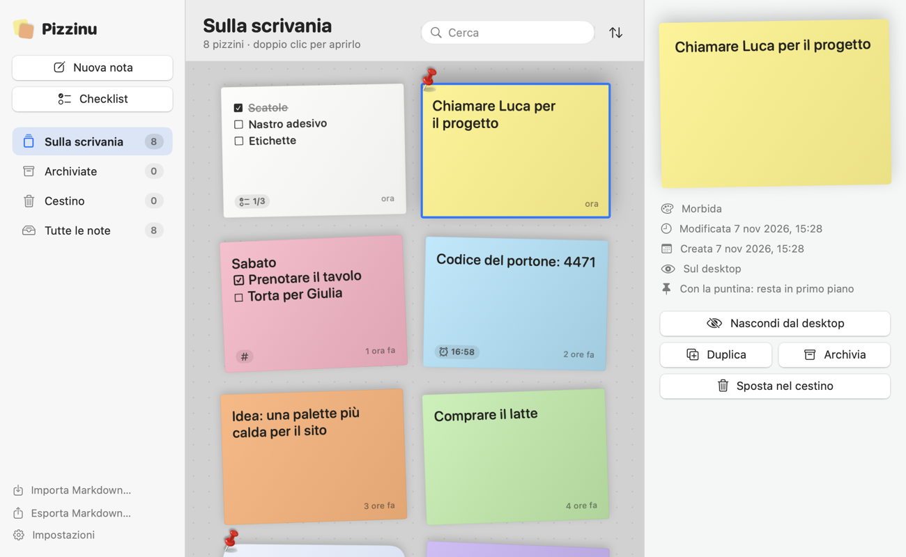

<p align="center">
  
</p>

<h1 align="center">Pizzinu</h1>

<p align="center">
  <b>Sticky notes for macOS that look like real paper.</b><br>
  Native, lightweight, private. No account, no cloud, no tracking.<br>
  An app by <a href="https://www.piratepixel.it">Piratepixel</a>.
</p>

<p align="center">
  <a href="https://github.com/piratepxl/pizzinu/releases/latest"><b>Download</b></a> ·
  <a href="https://www.piratepixel.it/pizzinu/">Website</a> ·
  <a href="https://t.me/pizzinuapp">Telegram</a> ·
  <a href="https://ko-fi.com/piratepxl">Buy me a coffee ☕</a> ·
  🇮🇹 <a href="README.it.md">Italiano</a>
</p>

<p align="center">
  <a href="https://github.com/piratepxl/pizzinu/releases"></a>
  <a href="https://github.com/piratepxl/pizzinu/releases/latest"></a>
  
  <a href="LICENSE"></a>
  <a href="https://t.me/pizzinuapp"></a>
</p>

<p align="center">
  
</p>

*Pizzinu* (Sicilian for "pizzino": a small folded note) puts every note on your desktop as a
floating sheet of paper, drawn in vector with real volume and shadows. Notes save themselves,
stay on your Mac, and are always one click away from the menu bar.

> **Language:** the app speaks **English** and **Italian**, and follows the language of your Mac.

## Features

- **Global shortcut ⌥⌘N.** From any app: press, type, hit **Esc** and you are back to work. An
  empty note disappears by itself. No Accessibility permission required.
- **Pin.** Pin a note and it stays above every other window, with a red pushpin on the paper.
- **Reminders.** A modern picker that starts with minutes (5, 10, 15, 30 min, 1–2 h), then
  suggestions (tonight, tomorrow morning…) and finally any day and time. When it is due, the note
  comes forward and **shakes** until you touch it. No system notifications.
- **Drag text onto the desktop.** Select a sentence in any app, drop it on the desktop: it
  becomes a note right where you dropped it.
- **Secret notes.** Lock a note with a password:
  - the text is encrypted with **AES-256-GCM**;
  - the key is derived with **PBKDF2-HMAC-SHA256 at 1,000,000 iterations**, a random salt per
    note and HKDF domain separation;
  - only ciphertext reaches the database, backups and exported files;
  - attempts are throttled after 3 wrong passwords;
  - open notes lock themselves after 5 idle minutes, on sleep, screen lock or screensaver;
  - the window is hidden from screenshots and screen sharing;
  - locked, the note **folds into a square in 3D** with a wax seal.
- **Markdown sheets.** Headings, bold, italic, strikethrough, highlight, code, quotes, lists,
  **clickable `- [ ]` tasks** and links, with a floating formatting toolbar.
- **Checklists** nested up to three levels, with two-way completion cascade.
- **14 paper themes**, assigned at random to new notes, including the system **Liquid Glass**
  (macOS 26), 12 named colours plus a custom one, and per-note fonts.
- **Archive** as a board or a list, with search, sorting, archive and a recoverable trash.
- **Automatic updates.** Once a day Pizzinu checks for a new version and shows what is new;
  one click downloads it, verifies its signature, replaces the app and reopens it.
- **Markdown import/export:** one `.md` file per note, readable in Obsidian or any editor.
- **Light:** about 25 MB of memory at rest and 0 % CPU. Pure AppKit + SwiftUI, no
  dependencies.

## Screenshots

**Every note is a real sheet of paper** on your desktop: drag it, write on it, pin it.

<p align="center"></p>

**13 paper themes**, plus system Liquid Glass on macOS 26. New notes get a random one.

<p align="center"></p>

**Markdown sheets** with a floating toolbar, **pin** and **reminders** with a picker that starts
with minutes.

<p align="center"></p>

**Secret notes**: encrypted with a password, they fold into a square sealed with wax.

<p align="center"></p>

**The archive**: every note as a sheet on a board, or as a compact list.

<p align="center"></p>

## Requirements

- Mac with **Apple Silicon** (M1 or later).
- **macOS 14 Sonoma** or later (Liquid Glass theme on macOS 26).

## Install

1. Download `Pizzinu-x.y.z.zip` from the
   [latest release](https://github.com/piratepxl/pizzinu/releases/latest) and unzip it.
2. Move **Pizzinu.app** to **Applications**.
3. The first time, macOS blocks it because the app is not notarised by Apple. Open
   **System Settings → Privacy & Security**, scroll down and click **Open Anyway** next to
   the message about Pizzinu, then confirm.

   Alternatively, in Terminal:

   ```bash
   xattr -dr com.apple.quarantine /Applications/Pizzinu.app
   ```

You only need to do this once.

## Build from source

You need Swift 6 and Apple's Command Line Tools (`xcode-select --install`); Xcode is not
required.

```bash
git clone https://github.com/piratepxl/pizzinu.git
cd pizzinu
bash build.sh            # → build/Pizzinu.app
bash build.sh --install  # also copies it to /Applications
```

Self-test of the core (451 checks):

```bash
swift run -c release PizzinuSelfTest
```

To make a release archive (`dist/Pizzinu-<version>.zip` plus its SHA-256):

```bash
bash Scripts/package_release.sh
```

More in [docs/INSTALL.md](docs/INSTALL.md).

## Keyboard shortcuts

| Action | Shortcut |
| --- | --- |
| **Quick note from any app** | **⌥⌘N** (global) |
| Stop writing (and return to the previous app) | Esc |
| New note / New checklist | ⌘N / ⇧⌘N |
| Note list / Search | ⌘L / ⌘F |
| Import / Export Markdown | ⇧⌘I / ⇧⌘E |
| Active / archived / trash | ⌘1 / ⌘2 / ⌘3 |
| Show / hide all notes | ⇧⌘M / ⇧⌘H |
| Markdown: bold, italic, link, code | ⌘B, ⌘I, ⌘K, ⌘E |
| Settings | ⌘, |

## Privacy

Notes live in
`~/Library/Application Support/Pizzinu` (folder readable only by your user), in a SQLite
database with secure delete enabled. No note content or personal data is ever collected or sent.

The only connection Pizzinu makes is a daily check for new versions on GitHub
(`api.github.com`): an anonymous request, which you can turn off in Settings ▸ Updates.
An update is installed only if its Ed25519 signature matches the key built into the app.

## Documentation

The technical documentation is in Italian:
[architecture](docs/ARCHITECTURE.md), [Markdown format](docs/MARKDOWN_FORMAT.md),
[tests](docs/TEST_REPORT.md), [performance](docs/PERFORMANCE.md),
[known limits](docs/LIMITS.md), [Nextcloud roadmap](docs/NEXTCLOUD_ROADMAP.md).

## About Piratepixel

Pizzinu is made by **Piratepixel**, the name under which I design and publish my software:
small, native apps that do one thing well, are light on your Mac and respect your privacy.

- Pizzinu's home page: **[piratepixel.it/pizzinu](https://www.piratepixel.it/pizzinu/)**
- Other Piratepixel projects: [piratepixel.it](https://www.piratepixel.it)
- Source code, downloads and bug reports: here on GitHub
  ([Releases](https://github.com/piratepxl/pizzinu/releases/latest) ·
  [Issues](https://github.com/piratepxl/pizzinu/issues))

## Community

- **Telegram channel** [@pizzinuapp](https://t.me/pizzinuapp): news and new versions.
- **Telegram chat** [@pizzinuchat](https://t.me/pizzinuchat): questions, tips and ideas with other users.
- Bugs and feature requests: [GitHub Issues](https://github.com/piratepxl/pizzinu/issues).

## Support

Pizzinu is free and open source. If it makes your day a little tidier, you can
[buy me a coffee on Ko-fi](https://ko-fi.com/piratepxl) ☕. Bug reports and ideas are welcome in
[Issues](https://github.com/piratepxl/pizzinu/issues).

## License

[MIT](LICENSE) © 2026 Piratepixel. Third-party code and font licences (SIL OFL) are listed in
[THIRD_PARTY_NOTICES.md](THIRD_PARTY_NOTICES.md).
